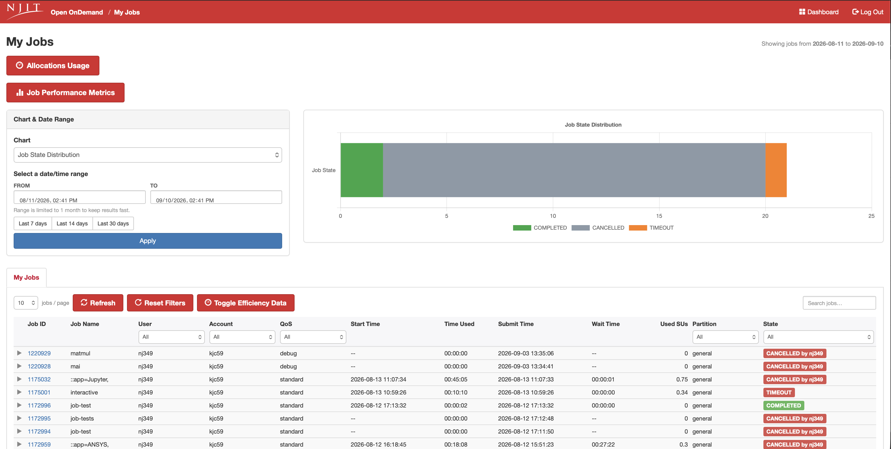

# My Jobs

My Jobs is a searchable history of the jobs you've run over a chosen date range,
with charts and per-job efficiency data.

{ width=100% height=100%}

### Toggle Efficiency Data

The **Toggle Efficiency Data** button adds a set of resource-efficiency columns
to the My Jobs table, showing how fully each completed job used the CPU, memory,
and time it was allocated. Click it once to reveal the columns; click again to
hide them and return to the standard view.

For each job, the efficiency columns report:

- **CPU Efficiency** — the percentage of your requested CPU time that the job
  actually used. A job that reserved many cores but kept most of them idle will
  show a low value. Low CPU efficiency usually means you requested more cores
  than the workload can use, or the job spent most of its time waiting on I/O
  rather than computing.

- **Memory Efficiency** — the peak memory the job actually used as a percentage
  of what it requested. A low value means you over-requested memory; a value
  near or above 100% means the job used nearly all it asked for (and a job that
  exceeds its request is at risk of being killed for going over the limit).

- **Time Efficiency** — how much of the requested walltime the job used before
  finishing. A job that asked for 24 hours but finished in 2 will show a low
  time efficiency. This doesn't waste SUs directly, but tighter walltime
  requests help the scheduler fit your job in sooner.

Efficiency is only meaningful for jobs that have finished running, so pending or
running jobs will not show useful values in these columns.

!!! tip "Why right-sizing matters"
    These numbers are the per-job detail behind the summary on the
    [Performance Metrics](performance-metrics.md) page. Consistently low CPU or
    memory efficiency means you're reserving resources the job never uses — which
    makes your jobs wait longer in the queue and can increase the SUs charged
    against your allocation. Use these columns to spot over-requested jobs, then
    lower the `--cpus-per-task`, `--mem`, or `--time` values in your batch script
    accordingly. See [Managing Jobs](../../Running_jobs/managing-jobs.md) for how
    to adjust these requests.

